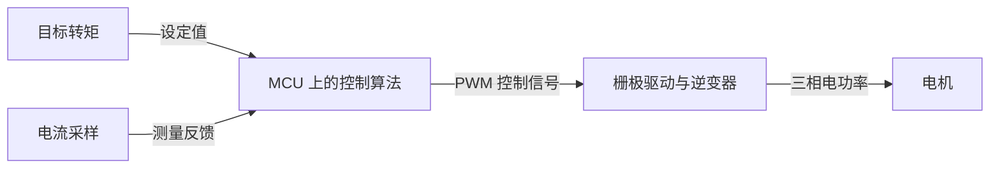

# 笔记格式与知识地图

模板是写作起点，生成时替换示例字段，删除不适用段落，不保留空标题。全部笔记使用 UTF-8。默认中文解释，保留通行英文术语。

## 概念笔记

每篇以一个可独立解释的概念为单位。正文通常控制在约 300–700 个中文字，按知识复杂度调整；清楚比硬凑字数重要。代码、图和来源可以额外占用篇幅。不要把底层知识无限展开，改为链接到前置概念。

````markdown
---
aliases: ["同义英文名或缩写"]
tags: ["嵌入式", "电机控制"]
---
# 概念名称

## 是什么
一两句话说明是什么、解决什么问题。

## 原理
用三到五步因果链解释输入如何变成输出；必要时解释公式里的物理量和成立条件。

## 实际怎么用
一个具体工程场景：谁使用它、为何需要它、主要限制是什么。

## 和其他组件如何交互
输入（信号、数据或能量）→ 本概念对应的组件或过程 → 输出。
明确组件职责和连接方式；涉及硬件时区分供电、控制、测量和通信。

## 易混淆点
区分最容易混淆的术语或边界。可加一两个简短自测问题和折叠答案，不记录答题历史。

## 关联与来源
- 前置：[[概念/前置概念]]，理解本概念需要它的具体原因。
- 应用：[[概念/相关概念]]，说明谁使用谁。
- [官方资料标题](https://example.com/实际来源)，标明所支持的参数或结论。
````

只保留实际存在的链接和核验过的来源。概念之间没有真实关系时，不凑关联条目。避免一篇笔记列出所有可能的应用。

## 图示

仅在能更快解释原理、数据流或组件交互时加入 Mermaid，通常三到七个节点。边必须标明含义；不要把浏览顺序当作信号链。



该图只是职责划分示例，不替代具体 FOC 的反馈、坐标变换及位置估计说明。Mermaid 节点是图示标签，实际知识导航仍使用正文双向链接。

## 主题导航与首页

初始主题可包括 Agent 开发、机器人系统、电机与控制、计算机体系结构、嵌入式与通信、软件基础。按实际内容创建，避免空目录或空主题页。一个概念允许出现在多个主题下，文件只存一份。

主题页包含：范围一句话、按依赖排列的学习路径、带关系说明的概念链接、必要的小图、当前待弄清的问题。学习路径用“建议先理解什么”表达，不推断用户掌握度。

首页包含：主题入口、主要跨领域联系、当前待解决问题。只有用户要求时才汇总当前概念总数或领域分布；注明统计范围，不记录增量、学习时长、提问次数、排行榜或历史趋势。不用 Dataview 等插件也应可读可用。

## 命名与歧义

- `AMD64`、`x86-64` 常指同一指令集体系的名称，使用一篇主笔记和 aliases；`x86` 可能指家族或 32 位语境，不能不加区别地全部合并。
- `arm63` 不是应直接接受的标准名称。先确认是否想问 `ARM64/AArch64`，不要静默替换或建立错误笔记。
- `ASIO` 可能指音频驱动接口，也可能指 C++ 异步 I/O 库（独立 Asio 或 Boost.Asio）。语境不明先问一个针对性问题；语境明确后使用区分名称。
- `FOC` 是控制方法，`MCU` 是运行控制程序的器件类别；分别维护，用关系连接。三相电、无刷电机和逆变器也不是同义概念。
- “英飞凌通信模块”不足以确定产品和参数：没有型号时只写确定的通用概念，将具体型号问题列为待确认，不猜测引脚、接口或电气参数。

## 目录调整

推荐起点是 `首页.md`、`概念/`、`主题/`、`附件/`，以已有 vault 结构为准。用户允许整理目录，不等于删除既有内容或改写 `.obsidian` 配置。

重命名或移动前搜索入链，兼顾完整路径和短链接、别名显示文本、标题/块锚点、嵌入图片及 Markdown 相对链接。先写入合并后的内容并修复引用，再移除确认冗余的旧文件；保留原有有效内容和附件。文件系统移动不会自动触发 Obsidian 的链接修复，操作后重新检查链接目标及锚点。

旧文件在全部引用验证成功前保留。若移动或引用修复中途失败，保留可恢复的原文件并报告实际完成范围，不继续删除。检测到同一笔记在操作期间再次变化时重新读取合并；同一段落存在无法判断的冲突时保留内容并向用户说明。
